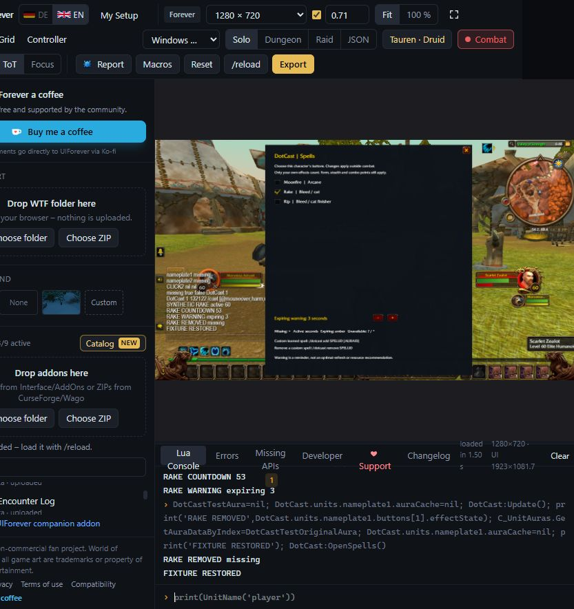

# DotCast

Clickable class damage-over-time spells and your own effect timers on enemy nameplates.

**WoW Forever · Interface 16001 · 0.1.3-beta**

## Install

In WowUp, select Forever, choose **Install from URL**, and enter `https://github.com/paden1991/DotCast` without `.git`. Select the Beta channel for this prerelease.

Alternatively, download `DotCast-0.1.3-beta-forever.zip` from [Releases](https://github.com/paden1991/DotCast/releases). Extract its `DotCast` folder into `Interface/AddOns`. New addon folders may require a full game restart. GitHub's automatic source-code archives are development source, not the installable asset.

Enable enemy nameplates. Use `/dotcast` or `/dcast` for appearance, or `/dotcast abilities` for per-character spell selection and the expiration warning. The minimap button opens appearance options. CounterCast is optional; DotCast reserves its nameplate footprint when present.

## Behavior

- Each physical left-click casts its assigned spell at hostile, living mouseover without changing the selected target. There is no automatic casting or spell selection.
- Tracks only your own harmful effects: missing, active, expiring, present with unreadable timing, or unknown. Unknown data never becomes a fabricated missing effect or timer.
- Active effects fade (35% default). Below two readable seconds, the icon flashes; a cooldown opacity of zero still keeps it invisible. Red indicates a definite out-of-range result.
- Appearance saves account-wide; spell choices, custom effects and macro ownership save per character.
- Secure layout and actions wait until combat ends. New nameplate roots first encountered in combat defer arming. Invisible artwork retains its click area in combat.
- Matching saved macros are reused, including full character macro lists. Existing macros are never deleted. A new ability without a matching macro still needs a free character macro slot.

The built-in catalog covers targeted DoT families for Druid, Warlock, Priest, Rogue, Warrior, Hunter, Shaman and Mage; Paladin has an explicit empty state. Only learned ranks appear. The catalog is not an exhaustive inventory of Forever talents or Legacy effects. Use `/dotcast add SPELLID` or `/dotcast add SPELLID AURAID` for an additional learned targeted ability; `/dotcast remove SPELLID` removes it. Up to eight custom entries are supported per character.

Other commands: `/dotcast on`, `/dotcast off`, `/dotcast refresh`, `/dotcast spells`, `/dotcast status`, `/dotcast errors`. Diagnostics catch only DotCast callbacks, retain up to eight distinct reports locally, and apply bounded retries. No diagnostics or SavedVariables are included in this repository.

## Visual and functional references



The image is an earlier UIForever simulation with synthetic aura inputs, not live casting footage. The release runtime is unchanged from the installed 0.1.3-beta build. See [validation](docs/VALIDATION.md) and [functional checks](docs/verification.json).

## Development and release verification

```sh
python -m pip install lupa
python tools/verify.py
python tools/build_local.py --verify-only
python tools/build_release.py
```

The manifest verifies all runtime bytes, TOC version and load order. `v<version>` tags trigger the release workflow, which publishes the installable Forever ZIP, `release.json` and SHA-256 checksum. These checks and the simulator do not certify real-client secure casting or restricted combat aura access.

## Ownership

Public visibility does not assign a new open-source license. Blizzard game imagery belongs to Blizzard Entertainment. This repository contains addon code, synthetic tests and documentation, not account SavedVariables, personal macro caches or diagnostic captures.
